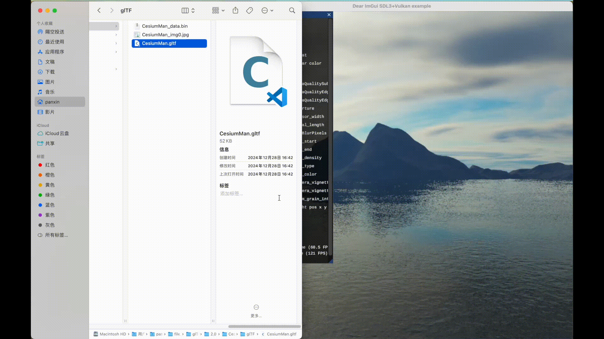
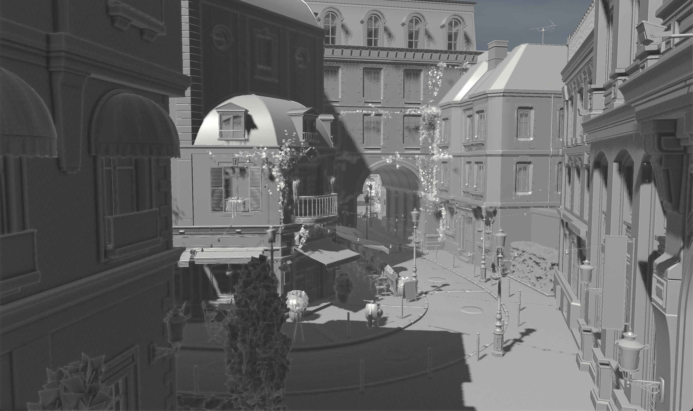

# 基于Vulkan从零开发的简单渲染引擎

## 实现的功能
- CSM 级联阴影
- SSAO 屏幕空间遮蔽
- Frustum culling 视锥体剔除




[](https://www.bilibili.com/video/BV1vney6TE5a/)


首次构建需要执行的命令有
``` 

git clone --depth 1                        https://github.com/danfis/libccd.git                                  external/libccd
git clone --depth 1 --branch  v1.3.2       https://github.com/USCiLab/cereal.git                                 external/cereal
git clone --depth 1 --branch  v1.17.0      https://github.com/google/googletest.git                              external/googletest
git clone --depth 1 --branch  v3.1.0       https://github.com/GPUOpen-LibrariesAndSDKs/VulkanMemoryAllocator.git external/VulkanMemoryAllocator
git clone --depth 1 --branch  v3.16.0      https://github.com/skypjack/entt.git                                  external/entt
git clone --depth 1 --branch  v11.0.2      https://github.com/odygrd/quill.git                                   external/quill
git clone --depth 1 --branch  v1.13        https://github.com/Chlumsky/msdfgen.git                               external/msdfgen
git clone --depth 1 --branch  v1.1         https://github.com/zeux/meshoptimizer.git                             external/meshoptimizer
git clone --depth 1 --branch  v4.4.2       https://github.com/KhronosGroup/KTX-Software.git                      external/ktx
git clone --depth 1 --branch  v3.3.1       https://github.com/jarro2783/cxxopts.git                              external/cxxopts
git clone --depth 1 --branch  v1.0.7       https://github.com/cameron314/readerwriterqueue.git                   external/readerwriterqueue
git clone --depth 1 --branch  20260107.1   https://github.com/abseil/abseil-cpp.git                              external/absl
wget -P external/tinyobj/  https://github.com/tinyobjloader/tinyobjloader/releases/download/v1.0.6/tiny_obj_loader.h 
```